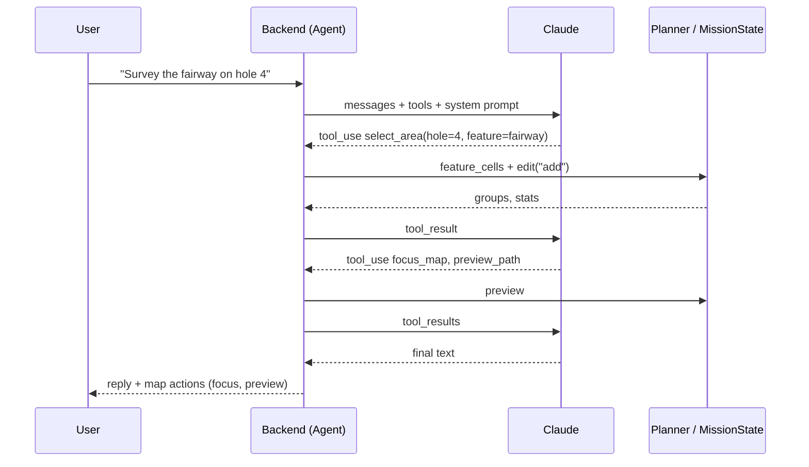

# Agent

## In this project

The chat panel is backed by Claude, which uses **tool calls** to drive the
same planner that the UI buttons use. "Survey the fairway on hole 4" becomes a
short series of tool calls: select the feature, pan the map, preview the
path. Then Claude replies with numbers that came back from the tools.

The main rule: **the agent never makes up geometry.** It doesn't compute
coordinates, areas, distances or times. Every number in its reply comes from
a tool result, and every change it makes shows up on the map as a normal
selection that the user can edit by hand.

| What | Where |
| --- | --- |
| Tool definitions, system prompt, loop | [`backend/app/agent.py`](../../backend/app/agent.py) (`TOOLS`, `system_prompt`, `Agent._loop`, `Agent.run_tool`) |
| Model and settings | [`backend/app/config.py`](../../backend/app/config.py) (`AGENT_MODEL`, `AGENT_EFFORT`, `AGENT_MAX_STEPS`) |
| HTTP endpoint | `POST /api/agent` in [`backend/app/main.py`](../../backend/app/main.py) |
| Tests (scripted client, no API calls) | [`backend/tests/test_agent.py`](../../backend/tests/test_agent.py) |

## Background

### Tool use

With **tool use** (function calling), the model is given a list of tools, each
with a name, a description and a JSON Schema for its inputs. Instead of
answering in text, the model can return a `tool_use` block. The application
runs the tool, sends back a `tool_result`, and calls the model again. This
repeats until the model replies with plain text. The model chooses which
tools to call and with what inputs, but the application runs them, and the
application decides what they are allowed to do.

### Why put an LLM on top of a deterministic planner

The planner is good at geometry and bad at understanding requests. The model
is the other way around. Splitting the work this way means:

- the parts that need to be correct (cell sets, paths, numbers) are ordinary
  tested Python, and give the same answer for the same input;
- the model only turns requests like "add hole 5's fairway" or "start over
  with the greens on 1 to 3" into tool calls;
- a wrong tool call is easy to see (the wrong cells light up) and easy to
  undo by hand.

## Our choices and limits

- **The tools** (`TOOLS`): `list_holes`, `select_area` (fairway, green, tees,
  or corridor for one hole, add or remove), `clear_selection`, `get_groups`,
  `focus_map`, `preview_path`. There is no tool to fly or abort. Starting a
  flight is always a human pressing **Fly**.
- **Map actions go to the UI.** `focus_map` and `preview_path` add actions
  (`focus`, `preview`) to the reply, and the frontend acts on them. The reply
  also carries a full state snapshot, so the map always shows what the agent
  selected.
- **The system prompt holds the course facts** (par, length and fairway area
  for each hole), so most requests don't need a `list_holes` call. It also
  sets the rules: quote tool numbers, a new survey request without "add"
  replaces the selection, say so when something is ambiguous instead of
  guessing.
- **Errors go back to the model.** A tool that raises an error, or rejects bad
  input (hole 12, a green that isn't mapped), returns `{"error": ...}` with
  `is_error`, so the model can fix the call or tell the user. If the API call
  itself fails, the turn's messages are rolled back so the history stays
  valid.
- **There are limits.** At most `AGENT_MAX_STEPS` (8) model calls per user
  message. The default model is Haiku, at medium effort, to keep demos cheap
  and fast (`AGENT_MODEL`, `AGENT_EFFORT`). Token use is logged and shown
  under each reply.
- **One conversation, one user.** The history is kept in memory and shared by
  the whole process, like the mission state. Restarting the backend or calling
  `POST /api/agent/reset` clears it.
- **Not yet supported:** selecting a box or brush area by description (the
  `select_box` tool), sortie and battery reasoning, and saved missions. These
  are planned for M2 and M3.
