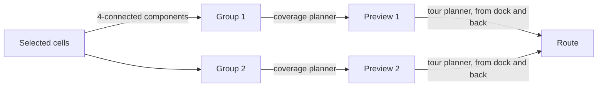

# Coordinate frame and grid

## In this project

All the geometry works in a flat local frame: meters east (x) and north (y)
of the dock. Over the frame sits a grid of 3 m square cells, with the dock on
a cell corner. Users and the agent pick cells, connected cells form
**groups**, and each group gets its own coverage path.

| What | Where |
| --- | --- |
| Local frame, cell math | [`backend/app/geo.py`](../../backend/app/geo.py) (`LocalFrame`, `cell_of`, `cell_center`, `CELL_M`) |
| The same math for the map | [`frontend/src/geo.ts`](../../frontend/src/geo.ts) (`LocalFrame`) |
| Grouping and stable group numbers | [`backend/app/planner.py`](../../backend/app/planner.py) (`components`, `regroup`) |
| The selection and its groups | [`backend/app/state.py`](../../backend/app/state.py) (`MissionState`) |
| Grid extent | [`backend/app/course.py`](../../backend/app/course.py) (`Course.cell_bounds`) |

> **Keep in sync:** `geo.py` and `geo.ts` must use exactly the same formulas,
> or a cell index will point to different squares on the map and in the
> planner. Nothing checks this automatically, so change both in the same PR.

## Background

### From lon/lat to meters

Latitude and longitude are angles. Path planning needs distances and areas in
meters, so the planner converts every point into a local Cartesian frame
first. The simplest option is the **equirectangular** (plate carrée)
approximation around a reference point (lat₀, lon₀):

$$
x = (\text{lon} - \text{lon}_0)\cdot R\cos(\text{lat}_0)\cdot\frac{\pi}{180},\qquad
y = (\text{lat} - \text{lat}_0)\cdot R\cdot\frac{\pi}{180}
$$

with R = 6,378,137 m (the WGS 84 equatorial radius). The error grows with
distance from the reference point. That is fine for an area about a kilometer
across, but it would not be for a whole city. The usual alternative is a
proper projection such as UTM or local ENU coordinates (for example with
`pyproj`).

### Rasterizing a region into cells

A **grid** turns "which ground should we survey?" into a set of integer
pairs. Sets are easy to edit by hand (toggle, add a box, remove a box), easy
to compare, and easy to send to the frontend. A shape becomes cells by testing
each cell's **center** against the shape: if the center is inside, the cell is
in.

### Connectivity

Two cells are **4-connected** if they share an edge, and **8-connected** if
they share an edge or a corner. Splitting a set of cells into connected
components is a flood fill (a depth-first search over neighbors).

## Our choices and limits

- **Dock-centered frame.** Using the dock as the origin means a cell index is
  also a distance from home, which makes routes, logs and tests easy to read.
  Moving the dock would move every cell, so saved selections (when they exist)
  would need to store lon/lat, not cell indices.
- **Equirectangular, not UTM.** The front nine fits in a box about
  1.0 km × 0.9 km around the dock (from `Course.cell_bounds`). At that size
  the error is far smaller than one 3 m cell, and the formula is short enough
  to copy into TypeScript exactly. If the project grows to areas many
  kilometers across, switch to a proper projection on both sides.
- **3 m cells.** This is a placeholder chosen for the demo. It is fine enough
  to follow fairway edges and coarse enough to click. It is not tied to the
  camera footprint (about 25 m at 15 m altitude), so the grid sets what gets
  selected, and the planner then decides how to fly it. See
  [decisions](../decisions.md).
- **Center-in-shape rasterization** (`Course.cells_in`). A cell counts if its
  center is inside the feature. The edges of a selection can therefore be off
  by up to half a cell (1.5 m) from the true shape.
- **4-connectivity, not 8.** Two cells that touch only at a corner form
  separate groups, because flying from one to the other would cross ground
  outside the selection. The downside is that a diagonal line of cells drawn
  by hand turns into many tiny groups.
- **Stable group numbers** (`regroup`). After each edit, every new component
  takes the number of the old group it overlaps most, starting with the
  biggest overlaps. Components that are new get the smallest free number. So
  "Group 2" keeps meaning the same thing while you or the agent change other
  groups. When a group is split, the bigger part keeps the old number.
- **Previews are invalidated by edits.** A group's preview is kept only if
  that group's cells are exactly the same after the edit (`MissionState._regroup`).
