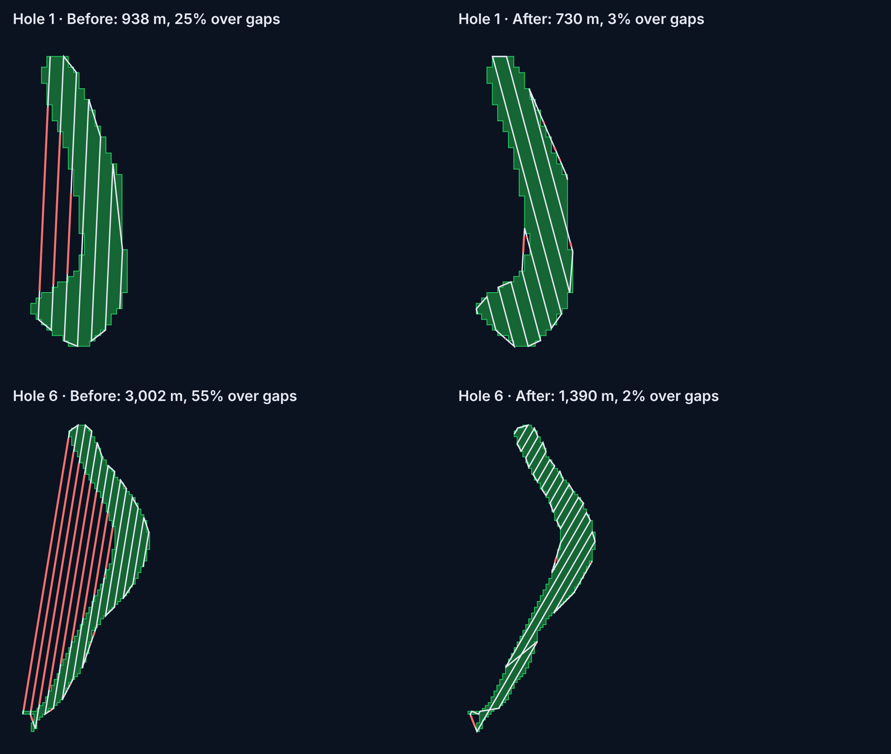

# Coverage path planning

## In this project

Given a group of selected cells, the planner produces a path that photographs
every part of it. The path is made of parallel back-and-forth passes (a
"lawnmower" pattern) and doesn't fly over ground outside the group. The
planner does four things:

1. **Pass spacing**: how far apart passes are, from altitude, camera field of
   view and sidelap.
2. **Boustrophedon decomposition**: splitting the group into **pieces** that
   can each be swept back and forth without leaving the shape. This is what
   keeps the drone over the fairway on curved and dogleg holes.
3. **Sweep angle search**: trying many pass directions and keeping the
   cheapest.
4. **Tour planning**: ordering the pieces (and, for the whole route, the
   groups) and choosing which end to enter each one from, so the hops between
   them are short.

| What | Where in [`backend/app/planner.py`](../../backend/app/planner.py) |
| --- | --- |
| Pass spacing | `pass_spacing_m`, constants `ALTITUDE_M`, `SIDELAP`, `CAMERA_HFOV_DEG` |
| Pass rows through a shape | `_scan_rows` (and `MAX_BRIDGE_M`) |
| Decomposition into pieces | `_decompose` |
| Four ways to fly a piece | `_piece_paths` |
| Angle search, whole pipeline | `preview_path` (and `SWEEP_ANGLES`, `FINALISTS`, `_quick_cost`) |
| Ordering + entry choice | `plan_tour`, `_chain_cost` |
| Dock → groups → dock route | `MissionState.route` in [`state.py`](../../backend/app/state.py) |

The effect, from the PR that added the decomposition (#2):



Before, hole 6 flew 3,002 m with 55% of it over the rough. After, it flies
1,390 m with 2% over gaps, split into 6 pieces. Across all nine fairways,
total pass length went from 8,731 m to 6,612 m.

## Background

### Coverage path planning

**Coverage path planning** (CPP) finds a path that passes a sensor's
footprint over every point of a region. For a camera drone the footprint is a
strip under the drone, so the standard answer is parallel passes, with each
pass overlapping the last one. The cost is mostly the total length, plus the
turns at the end of every pass, since a multirotor has to slow down, turn and
speed up again.

### Pass spacing

At altitude *h* with a horizontal field of view *θ*, one image covers a strip
of ground this wide:

$$ w = 2h\tan(\theta/2) $$

Photogrammetry needs neighboring strips to overlap (**sidelap** *s*) so the
images can be matched and stitched, which gives this spacing between passes:

$$ d = w\,(1 - s) $$

With the current placeholders (15 m, 80°, 70%): *w* ≈ 25.2 m and
*d* ≈ 7.55 m.

### Boustrophedon cell decomposition

*Boustrophedon* means "as the ox turns": plowing one row, turning, and plowing
back. Back-and-forth passes cover a **convex** shape perfectly. A non-convex
shape (a dogleg fairway, or one with a bunker cut out of it) has pass lines
that leave the shape and come back. Flying those lines straight means flying
over ground you didn't want to survey.

**Boustrophedon cell decomposition** (BCD; Choset and Pignon, 1997) fixes this
by cutting the region into sub-regions that can each be covered back and forth
without leaving. It moves a line (the "slice") across the region in the sweep
direction and watches how many separate segments the slice cuts out of the
region:

- When **one segment splits into two** (the slice reaches the near side of an
  obstacle or the fork of a dogleg), the current sub-region ends and two new
  ones start.
- When **two segments merge into one**, the two sub-regions end and a new one
  starts.
- In between, the number of segments stays the same, and each segment just
  grows or shrinks. That stretch is one sub-region, and it can be swept back
  and forth.

The points where splits and merges happen are called **critical points**.
Each sub-region is covered on its own, and a separate step chooses the order
to visit them in. That ordering step is a small travelling salesman problem.

```
 slice moves this way ──▶
                            ┌──────── piece B ────────
 ───── piece A ─────────────┤        (split event)
                            └──────── piece C ────────
```

### Choosing the sweep direction

The decomposition depends on the sweep direction. A fairway swept along its
length gives a few long passes, while sweeping it across gives many short
passes and many turns. The direction also changes where the critical points
are, and so how many pieces there are. A common heuristic is to sweep along
the shape's long axis. We search instead, because on a dogleg the long axis
of the whole shape is often wrong for both legs.

### Tour ordering

Once the pieces are known, they have to be visited in some order. Each piece
can be flown 4 ways (start at either end, first pass going left or right), and
each choice puts the drone in a different spot to start the next piece. This
is a small **generalized TSP**. With the handful of pieces we have, a
nearest-neighbor start improved by **2-opt** (reverse any section of the
order if that makes the tour shorter) gets close to optimal in no time.

## How our implementation works

`preview_path(cells)`:

1. Merge the cells into one polygon.
2. For each sweep angle (0° to 175° in 5° steps, plus the polygon's long axis):
   1. Rotate the polygon so the passes run horizontally.
   2. **`_scan_rows`**: lay pass rows `d` apart, centered on the shape. On each
      row, intersect the center line and the band within ±d/2 of it with the
      polygon. Each connected strip of the band becomes one pass segment, so
      a ragged 3 m stair-step edge doesn't chop a row into tiny bits. Gaps of
      `MAX_BRIDGE_M` (6 m, two cells) or less are bridged rather than split.
   3. **`_decompose`**: go through the rows in order. A piece keeps growing
      while exactly one segment in the next row overlaps it, and that segment
      overlaps nothing else. Any split, merge, or appearing or disappearing
      segment closes the piece and starts new ones.
   4. Score the angle with `_quick_cost`: total pass length, plus a turn
      penalty for each pass, plus greedy hops between pieces.
3. Plan the best `FINALISTS` (5) angles fully with `plan_tour`, always
   including the long axis. Keep the cheapest by length plus turn penalty.
4. Rotate the winning path back and return it as a `Preview` (waypoints,
   length, passes, heading, estimated time, piece count).

`plan_tour` is used twice: inside a group to order its pieces, and in
`MissionState.route` to order the previewed groups from the dock and back.
For a given order, `_chain_cost` picks each item's entry variant **exactly**
by dynamic programming over the 4 variants per piece (2 per group: forward or
reversed). Only the order itself is heuristic (nearest neighbor, then up to 20
rounds of 2-opt).

## Our choices and limits

- **This is BCD on scanlines, not exact BCD.** The split and merge rule is the
  same as Choset's, but it is checked only at pass rows. Exact BCD finds
  critical points on the polygon's vertices. In ours, a piece boundary can be
  up to one pass spacing (about 7.5 m) from where the exact method would put
  it. This keeps the algorithm short (about 30 lines), it works directly on
  the rows we fly anyway, and it can't produce a piece narrower than one pass.
  The cost is that the decomposition isn't minimal. Treat a piece count as
  "what this planner did", not as a property of the fairway.
- **Bridging small gaps is on purpose.** Splitting at every 3 m notch in the
  cell staircase would create many tiny pieces and many extra turns. Flying
  straight across a gap of 6 m or less costs less. This accounts for most of
  the 2–3% "over gaps" that is left.
- **Pass ends are not extended.** A pass runs from where its center line
  enters the shape to where it leaves. The images do reach a little past each
  end (along-track footprint), but we don't model this. Corners of the shape
  between the ends of neighboring passes may get thin coverage.
- **Turns are a flat penalty.** Each pass after the first costs
  `TURN_PENALTY_S` (3 s) in the time estimate and the equivalent distance in
  the planner's cost. Real turn time depends on the turn angle and the
  airframe. Hops between pieces and between groups get no extra turn penalty.
- **No wind, no altitude changes, no obstacles.** Trees, flagsticks and
  no-fly areas aren't modeled. The path is 2D at a fixed altitude.
- **Single battery.** The route is assumed to fit on one charge. Splitting it
  into sorties with charge stops at the dock comes in M2 and M3, and will need
  `plan_tour` to cope with a length limit per sortie.
- **Every number is a placeholder.** Altitude, field of view, sidelap, speed
  and turn time are set in `planner.py` until the camera and airframe are
  chosen. The UI shows the current values (`/api/state` → `assumptions`).

## Further reading

- H. Choset, P. Pignon. *Coverage Path Planning: The Boustrophedon Cellular
  Decomposition.* Field and Service Robotics, 1997.
- E. Galceran, M. Carreras. *A survey on coverage path planning for
  robotics.* Robotics and Autonomous Systems 61(12), 2013.
- T. M. Cabreira, L. B. Brisolara, P. R. Ferreira Jr. *Survey on Coverage Path
  Planning with Unmanned Aerial Vehicles.* Drones 3(1), 2019.
