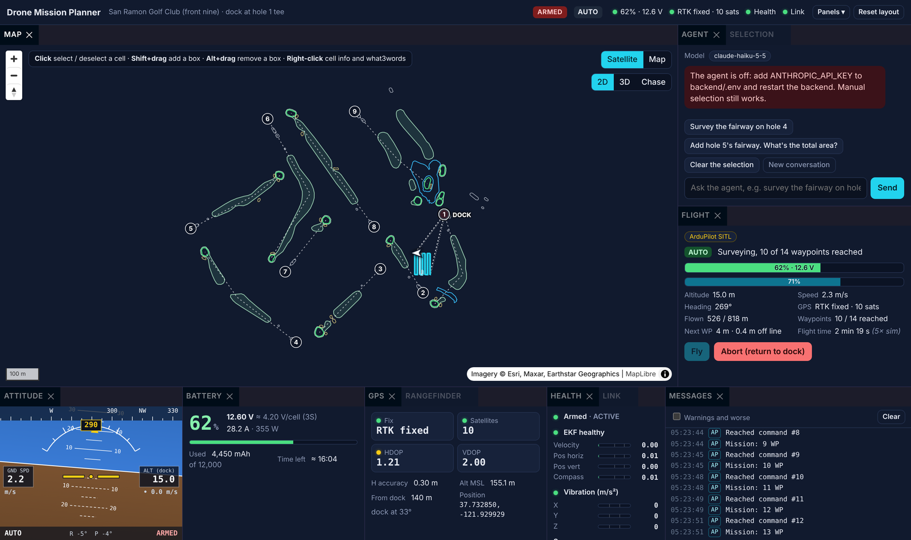

# Flight dashboard

## In this project

The web app is a dashboard of panels. Each part of the app (the map, the
agent, the selection, the flight controls) and each in-flight instrument is a
panel with a tab. You can:

- **move** a panel by dragging its tab to another edge, or into another
  panel's tab strip to stack them as tabs,
- **resize** panels by dragging the borders between them,
- **float** a panel by holding Shift while you drag its tab (a closed panel
  that you reopen also comes back floating),
- **close** a panel with its ×, and bring it back from **Panels** in the top bar,
- **Reset layout** to put everything back.

The layout is saved in the browser's `localStorage`, so each browser keeps its
own. A layout saved by an older version that names a panel this version
doesn't have is ignored and the default is used.

The instrument panels show what a ground station such as QGroundControl
shows during a flight:

| Panel | Shows | From (ArduPilot over MAVLink) |
| --- | --- | --- |
| Attitude | Artificial horizon (roll, pitch), heading tape, ground speed, altitude above the dock, climb rate, mode, armed | `ATTITUDE`, `VFR_HUD`, `GLOBAL_POSITION_INT`, `HEARTBEAT` |
| Battery | Percent, voltage and estimated per-cell voltage, current, power, mAh used of the pack, time left | `SYS_STATUS`, `BATTERY_STATUS`, parameter `BATT_CAPACITY` |
| GPS | Fix type, satellites, HDOP and VDOP, horizontal accuracy, MSL altitude, distance to the dock | `GPS_RAW_INT`, `GLOBAL_POSITION_INT` |
| Health | Ready to arm (and the last `PreArm:` reasons), system state, EKF flags and variances, vibration and clipping, sensor health lights | `SYS_STATUS` bits, `STATUSTEXT`, `EKF_STATUS_REPORT`, `VIBRATION`, `HEARTBEAT` |
| Messages | The autopilot's text messages with severity and time, plus the planner's own events (connected, mode changes, armed, mission uploaded, landed) | `STATUSTEXT` |
| Link | Whether the browser is getting telemetry, autopilot heartbeat age, packet loss, the vehicle's own drop rate, RC signal | `HEARTBEAT`, MAVLink sequence numbers, `SYS_STATUS`, `RC_CHANNELS` |
| Rangefinder | Downward distance, in range or not, compared with altitude | `DISTANCE_SENSOR` (pointing down) |
| Flight | Fly and Abort, the mode and message, mission progress, waypoints reached, distance to the next waypoint and off the line | `MISSION_CURRENT`, `MISSION_ITEM_REACHED`, `NAV_CONTROLLER_OUTPUT` |

The top bar repeats the essentials (armed, mode, battery, GPS, an overall
health light, link) so they stay visible with any layout.

Where it is in the code:

- `frontend/src/layout.ts`: the panel list (`PANELS`), the default layout,
  saving and restoring, and the Panels menu. Panel contents are the
  `data-panel` elements in `frontend/index.html`.
- `frontend/src/panels.ts`: the instrument panels, the message log and the
  top bar status, with the color thresholds.
- `frontend/src/hud.ts`: the attitude indicator, drawn on a canvas.
- `backend/app/vitals.py`: the shared pieces: the message log
  (`MessageLog`), sensor bits, EKF and vibration levels, the rangefinder's range.
- `backend/app/sitl_drone.py` (`SitlDrone._handle` and `_vitals`): reads the
  MAVLink messages above. `backend/app/sim.py` sends the same fields with
  placeholder health values.
- The telemetry WebSocket (`/ws/telemetry`, 5 Hz) carries everything,
  including the last 12 log messages. `GET /api/messages` returns the whole
  log (up to 300) when the page loads.

## Background

A **ground control station** (GCS) such as QGroundControl or Mission Planner
does two jobs. One is **setup**: firmware, sensor calibration, radio and
flight mode setup, parameters, tuning. The other is **monitoring and
commanding** a flight: where the vehicle is, its attitude, battery, GPS,
whether it is healthy, and what the autopilot is saying. This dashboard is the
second job only.

What the panels mean:

- **Attitude indicator.** The horizon tilts with roll and moves with pitch,
  as in a cockpit. The roll pointer is on the arc at the top.
- **HDOP** (horizontal dilution of precision) is how well the satellites'
  geometry fixes position. Under about 1.2 is good; above 2 is poor.
  ArduPilot will not arm with HDOP above `GPS_HDOP_GOOD` (1.4 by default).
- **EKF** is ArduPilot's extended Kalman filter, which fuses IMU, GPS,
  compass and barometer into the position and attitude the autopilot flies
  on. `EKF_STATUS_REPORT` gives its flags (which estimates are usable) and
  variances (how much each sensor disagrees with the estimate, normalized so
  1.0 is the rejection limit). Mission Planner colors them green under 0.5,
  amber to 0.8 and red above; we do the same.
- **Vibration** is the accelerometer's high-frequency noise in m/s/s.
  ArduPilot's guide says under 30 is fine and over 60 often causes position
  and altitude problems. **Clipping** counts samples that hit the sensor's
  limit; any increase in flight is bad.
- **Pre-arm checks.** Before arming, ArduPilot checks sensors, calibration,
  GPS, EKF, battery, RC and more. Failures come as `PreArm: ...` text
  messages and the `PREARM_CHECK` health bit in `SYS_STATUS`.
- **STATUSTEXT** messages carry a severity from 0 (emergency) to 7 (debug).
  4 is a warning and 3 an error; the panel colors them and can filter to
  warnings and worse.

## Our choices and limits

- **Monitoring only. QGroundControl stays the tool for setup.** Parameters,
  calibration (accelerometer, compass, radio, ESC), firmware, flight mode
  setup, motor tests, log download and tuning are not in the web app and
  shouldn't be: QGC and Mission Planner do them well, and a mistake there can
  make the drone unsafe. Connect QGC on port 5762 next to the planner (see the
  main README). See [D9](../decisions.md#d9-an-in-flight-dashboard-in-the-web-app-qgc-for-setup).
- **The only commands are Fly and Abort (RTL).** There is no takeoff, land,
  change mode, pause or go-to button yet. Adding them is easy over MAVLink,
  but each one is a way to send a wrong command to a real drone, so they
  should come with confirmation and a decision about who is in control (the
  RC pilot always wins).
- **dockview for the layout.** See D9 for why.
- **The built-in sim's health values are placeholders.** It has no sensor
  model, so its EKF, vibration, sensors and link always look healthy, and the
  panels say so. Battery and rangefinder follow its simple models. Use SITL to
  see real values.
- **SITL is not the airframe.** It is ArduPilot's generic quad on a 3S
  battery model, so the battery panel shows about 12.6 V and "3S", with the
  placeholder capacity from `sitl/planner.parm`. SITL reports zero vibration
  unless `SIM_VIB_*` is set. The rangefinder is SITL's simulated one (type
  100) with the TFmini-S's 0.1 to 12 m range.
- **The rangefinder can't see the ground at survey altitude.** The airframe's
  TFmini-S reads up to 12 m (less on grass in sunlight), and the survey flies
  at 15 m, so it reads only during takeoff and landing. That is fine for
  landing on the dock, but terrain following at 15 m would need a longer
  range lidar or a lower altitude.
- **Per-cell voltage is estimated** from the pack voltage (the cell count is
  guessed from the first reading). With a PM02 power module ArduPilot only
  measures the whole pack. The PM02's voltage and current scales need
  calibrating (`BATT_VOLT_MULT`, `BATT_AMP_PERVLT`) before the current, mAh
  and time left are trustworthy.
- **RC signal shows only if ArduPilot reports RSSI.** With ExpressLRS over
  CRSF set `RSSI_TYPE` 3 (receiver protocol) for link quality.
- **The planner needs a MAVLink path to the real drone.** The airframe has an
  ELRS receiver and no telemetry radio. ELRS can carry MAVLink in its MAVLink
  mode with the TX backpack, at low bandwidth, or a separate telemetry radio
  or an onboard computer can. Until one is chosen, the dashboard works only
  with SITL.
- **5 Hz telemetry.** The attitude indicator eases between updates; fast
  oscillations won't show. QGC typically asks for attitude at higher rates.
- **One browser, one layout.** Layouts are saved per browser, not per user or
  shared. Phones get the same layout squeezed; it is meant for a laptop or a
  larger screen.
