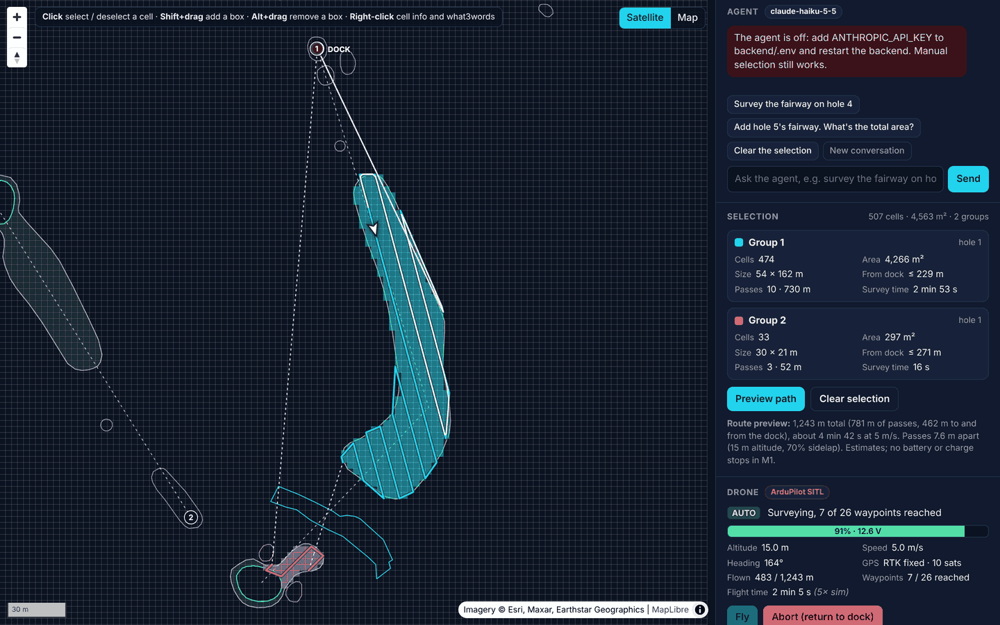
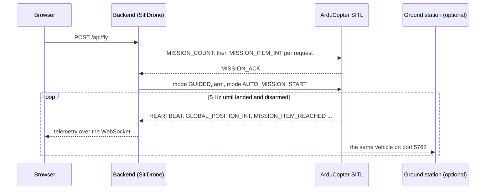
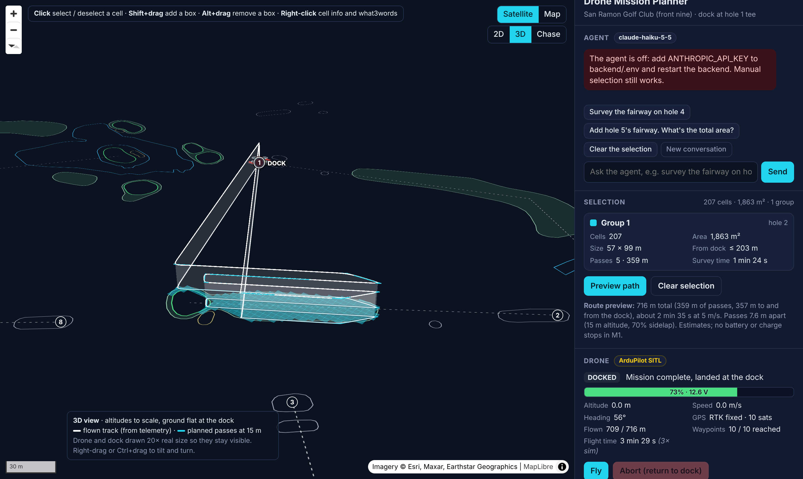
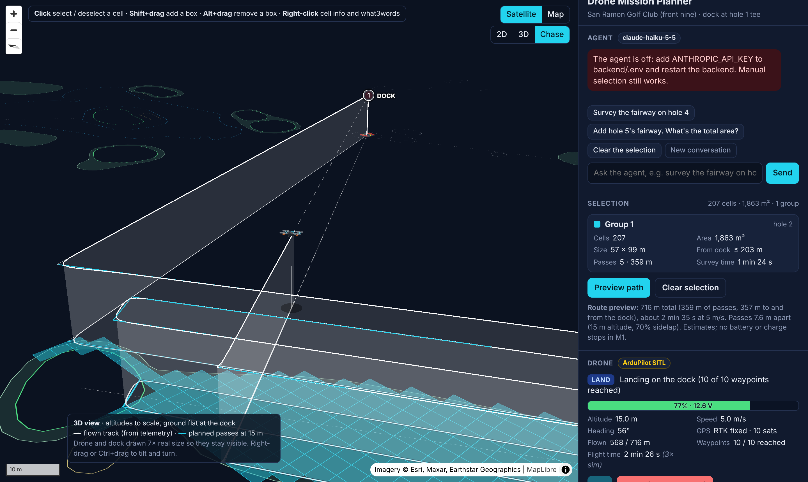

# ArduPilot SITL and MAVLink missions

## In this project

With `FLIGHT_BACKEND=sitl`, the **Fly** button no longer moves a point along
the route itself. It turns the planner's route into an ArduPilot mission,
uploads it over MAVLink to ArduPilot SITL (a generic ArduCopter quad), and
shows the autopilot's own telemetry on the map. Abort switches the autopilot
to RTL. The API and the frontend are the same for both backends, so
everything else (selection, groups, previews, the agent) is unchanged.

| What | Where |
| --- | --- |
| Route to mission items, mission upload and download | [`backend/app/mavlink_mission.py`](../../backend/app/mavlink_mission.py) (`build_mission`, `upload_mission`, `download_mission`, `nav_seqs`) |
| Arm, fly, abort, telemetry over MAVLink | [`backend/app/sitl_drone.py`](../../backend/app/sitl_drone.py) (`SitlDrone`) |
| Which backend, where SITL is | [`backend/app/config.py`](../../backend/app/config.py) (`FLIGHT_BACKEND`, `SITL_CONNECTION`) |
| Headless flight with a pass/fail report | [`backend/tools/fly_sitl.py`](../../backend/tools/fly_sitl.py) |
| Task-queue legs as missions, recharge | `build_leg_mission` in `mavlink_mission.py`; `start_leg`, `leg_progress`, `recharge` in `sitl_drone.py`; headless run in [`backend/tools/fly_queue.py`](../../backend/tools/fly_queue.py). See [Task queue](task-queue.md) |
| SITL container, start script, parameters | [`sitl/`](../../sitl/) (`Dockerfile`, `compose.yaml`, `run-sitl.sh`, `planner.parm`) |
| Tests | [`backend/tests/test_mavlink_mission.py`](../../backend/tests/test_mavlink_mission.py) (no SITL needed), [`backend/tests/test_sitl_flight.py`](../../backend/tests/test_sitl_flight.py) and [`test_sitl_queue.py`](../../backend/tests/test_sitl_queue.py) (fly on SITL, skipped unless `SITL_TEST=1`) |
| CI: backend tests, then the SITL flight and task queue tests against the cached image | [`.github/workflows/ci.yml`](../../.github/workflows/ci.yml) |

The mission for a route (dock, survey points, dock) is:

| seq | Item | Notes |
| --- | --- | --- |
| 0 | Home | The dock. ArduPilot replaces it with where it armed, which is also the dock. |
| 1 | `NAV_TAKEOFF` | To `planner.ALTITUDE_M`, straight up from the dock. |
| 2 | `DO_CHANGE_SPEED` | Ground speed `planner.CRUISE_SPEED_MS`, so flight time matches the estimates. |
| 3.. | `NAV_WAYPOINT` | Every route point between the two dock visits, at survey altitude. Points under 0.5 m apart are merged. |
| last | `NAV_LAND` | At the dock. Copter flies there at altitude, descends and disarms. |

Altitudes are relative to home, so the dock's height above sea level does not
matter.

A task-queue leg uses the same frame (home, takeoff, speed, ..., `NAV_LAND`
at the dock), with three `NAV_WAYPOINT`s per task: over it at cruise
altitude, down at the service altitude with a hold (param1, seconds), and
back up. A task counts as done once `MISSION_CURRENT` moves past its service
waypoint (the hold is over) or the autopilot reports reaching the climb-out
waypoint. Between legs, `recharge` sends `MAV_CMD_BATTERY_RESET` so the
battery monitor reads full again; that is simulation only.



*The planner's map during a SITL flight of hole 1 (the cloud test machine
has no satellite tiles, so the background is plain). The white line is the
autopilot's actual track over the planned passes.*



### Running it

**Headless (Linux, the cloud, CI).** Build SITL once with Docker
(`docker compose -f sitl/compose.yaml up --build`), or build ArduPilot
yourself and run `sitl/run-sitl.sh` with `arducopter` on the `PATH`. Then:

```bash
cd backend
uv run python -m tools.fly_sitl --hole 2          # prints progress and a JSON report
SITL_TEST=1 uv run pytest tests/test_sitl_flight.py -s
```

`fly_sitl` exits 0 only if the autopilot reported every survey waypoint
reached, in order, and the vehicle landed and disarmed within 3 m of the
dock. Start SITL with `SPEEDUP=10` to run a test in about a tenth of the
flight time.

**Visual demo (Windows).** See [Fly on ArduPilot SITL](../../README.md#fly-on-ardupilot-sitl)
in the main README. SITL runs in Docker Desktop, the planner runs as usual,
and the drone is drawn on the planner's own map. A ground control station
(QGroundControl or Mission Planner) can connect to TCP port 5762 at the same
time to show the same flight in a standard autopilot view.

## 3D view

The **2D / 3D / Chase** buttons under the basemap toggle switch how the
flight is shown. They work for both flight backends.

- **3D** tilts the map toward the route. The quad flies at its reported
  altitude and attitude, the planned passes hang at survey altitude in their
  group color, and the flown track is a white line with a faint curtain down
  to the ground, so climbs, the survey altitude and the landing read at a
  glance. Right-drag (or Ctrl+drag) tilts and turns the camera.
- **Chase** keeps the drone in the middle of the screen and turns slowly to
  look along its heading. Dragging the map drops back to 3D.
- **2D** is the top-down planning view, with the grid.





*Hole 2 flown on ArduPilot SITL from the Fly button (10 of 10 waypoints,
landed on the dock). The cloud test machine has no satellite tiles, so the
ground is plain; on a normal connection it is the satellite image.*

| What | Where |
| --- | --- |
| Quad model, dock, 3D route and track (three.js in a MapLibre custom layer) | [`frontend/src/view3d.ts`](../../frontend/src/view3d.ts) (`Flight3D`) |
| View toggle, chase camera, legend | [`frontend/src/main.ts`](../../frontend/src/main.ts) (`setView`, `chaseCamera`) |
| Roll and pitch in telemetry (from MAVLink `ATTITUDE`) | [`backend/app/sitl_drone.py`](../../backend/app/sitl_drone.py) |

What is real and what is drawn:

- Position, altitude, heading, roll and pitch come from the autopilot's
  telemetry at 5 Hz and are smoothed between updates. The built-in sim
  reports a fixed 5 degree nose-down pitch while cruising and no roll.
- The ground is flat at the dock's height. Mission altitudes are relative to
  the dock too, so the picture matches what the autopilot flies, but it
  doesn't show real terrain.
- The model is a generic X quad about 0.5 m across. Zoomed out, it and the
  dock are drawn larger (up to 20 times) so they stay visible; the legend
  says by how much. The dock is a pad with the two side bars that center the
  drone on its charging contacts.

## 3D buildings and trees

The 3D view puts the course's surroundings under the flight, in two layers:

1. **OSM building boxes** (always, free). Building footprints from
   OpenStreetMap, extruded to their `height` tag, or `building:levels` x 3 m
   + 1 m, or a guess by building type (a house is 6 m). They show at once.
2. **Google Photorealistic 3D Tiles** (with `GOOGLE_MAPS_API_KEY`). The
   textured mesh of the real houses, clubhouse and trees. They stream in on
   top, and the boxes fade out once they have loaded. If Google fails (bad
   key, quota, no network), the boxes stay and the legend says why.

The drone, route and track are drawn in the same 3D scene, so a house or a
tree in front of the drone hides it, and a pass that goes through a tree
shows it.

**Setting up the key.** In Google Cloud: create a project with billing on,
enable the **Map Tiles API**, create an API key, and restrict it to the Map
Tiles API and to the referrers `http://localhost:8000/*` and
`http://localhost:5173/*`. Put it in `backend/.env` as
`GOOGLE_MAPS_API_KEY=...`. The key is sent to the browser (the tiles are
fetched from there), which is why the restrictions matter. To cap the cost,
lower the Map Tiles API quota for root tileset requests per day (Cloud
Console > Map Tiles API > Quotas), for example to 50.

**Cost.** Google bills a session: one root tileset request, which allows
3 hours of tile requests. The first 1,000 a month are free, then $6 per
1,000 (November 2026 price list). The app opens one session per page load,
and only on the first switch to 3D or Chase; the 2D view never contacts
Google. Limiting tiles to the area around the route would not lower the
bill, because tiles inside a session are not billed.

**No tile cache.** Google's terms allow only the browser's normal HTTP cache,
which follows the expiry headers Google sends. We don't store or pre-fetch
tiles, so the demo needs a network connection for the photorealistic layer.

**Look, don't measure.** The terms also forbid extracting data from the
tiles (object detection, deriving 3D models). The mesh is for looking at:
it can show that a pass runs into a tree, but the planner must not compute
clearances from it. For automated obstacle checks, use public LiDAR (USGS
3DEP) instead.

**Height.** Google's mesh has real ground heights. We measure the mesh's
ground under the dock and shift the mesh so that point is at 0 m, which is
where the mission's altitudes start. Elsewhere on the course the ground can
be above or below the dock, so the drone's height over the local ground
differs from its altitude by that much, as it does in the real flight.

**OSM data.** The backend gets the buildings once from the Overpass API and
caches them in `backend/var/osm_buildings.json`. To make that a committed
snapshot, so the demo doesn't depend on Overpass, run
`uv run python -m tools.fetch_buildings` and commit
`backend/app/data/osm_buildings.json`.

| What | Where |
| --- | --- |
| OSM buildings (fetch, heights, cache) | [`backend/app/buildings.py`](../../backend/app/buildings.py), [`backend/tools/fetch_buildings.py`](../../backend/tools/fetch_buildings.py) |
| Google tiles: session, placement at the dock, level-of-detail camera | [`frontend/src/photoreal.ts`](../../frontend/src/photoreal.ts) |
| Boxes vs mesh, attribution | [`frontend/src/main.ts`](../../frontend/src/main.ts) (`setup3dWorld`, `applyWorldLayers`) |

## Background

**ArduPilot** is open-source autopilot firmware. **SITL** (software in the
loop) compiles the same flight code for a PC and connects it to a simple
physics model instead of real sensors and motors. The mission logic, flight
modes, arming checks and failsafes are the real ones. The physics, sensors and
battery are simulated, so SITL tells you whether a mission is valid and how
the autopilot will fly it, but not how a particular airframe handles wind.

**MAVLink** is the message protocol between autopilots and ground software.
A mission is uploaded with a short handshake: the ground side sends
`MISSION_COUNT`, the vehicle asks for each item by number
(`MISSION_REQUEST_INT`), and replies `MISSION_ACK` when it has them all. Each
item is a command (`NAV_WAYPOINT`, `NAV_TAKEOFF`, `NAV_LAND`, `DO_...`) with
up to seven parameters. Positions are sent as integers in 1e-7 degrees,
which is about 1 cm.

In **AUTO** mode the autopilot runs the mission item by item and sends
`MISSION_ITEM_REACHED` as it passes each waypoint. **RTL** (return to launch)
climbs if needed, flies back to where it armed and lands. **GUIDED** takes
commands from the ground station one at a time.

## Our choices and limits

- **SITL runs headless, and the visual is the planner's map, in 2D or 3D.**
  We don't run Gazebo or another 3D simulator. The **3D** and **Chase**
  buttons tilt the planner's map and draw the quad at its real altitude,
  heading, roll and pitch, with the planned passes at survey altitude and the
  flown track in 3D (see [3D view](#3d-view) below). A ground station on port
  5762 adds the standard autopilot view. Gazebo would need a Linux GUI (WSLg
  or noVNC on Windows), GPU or slow software rendering, and a model of the
  course, for a picture of the same generic quad. See decisions
  [D6](../decisions.md#d6-run-sitl-headless-in-docker-and-show-it-on-the-planners-map) and
  [D7](../decisions.md#d7-show-flights-in-3d-on-the-planners-map-not-in-gazebo).
- **Copter needs `MISSION_START` to take off in AUTO.** On the ground,
  switching to AUTO waits for the pilot to raise the throttle. We arm in
  GUIDED, switch to AUTO and send `MISSION_START`, which starts the mission
  without a throttle input.
- **We trust `MISSION_ITEM_REACHED`.** "Reached" means ArduPilot's own
  waypoint logic counted it, which in Copter is the waypoint radius
  (`WPNAV_RADIUS`, 2 m by default). Copter rounds corners, and in our flights
  the track stayed within about 1.5 m of the planned lines (holes 2 and 6,
  November 2026). The test allows 8 m.
- **Copter doesn't report reaching `NAV_LAND`.** Landing is checked by the
  final position and the vehicle disarming instead.
- **Battery is a placeholder.** `sitl/planner.parm` sets `BATT_CAPACITY` so a
  full pack lasts about 20 minutes, like the built-in sim. The stock 3300 mAh
  ran out in about 6 minutes, before a long fairway was done. Low-battery
  failsafes are off, as in ArduPilot's SITL defaults. The real pack and
  failsafe settings come with the airframe.
- **A simulated downward rangefinder.** `sitl/planner.parm` adds SITL's
  rangefinder (`RNGFND1_TYPE` 100) with the TFmini-S's 0.1 to 12 m range, so
  the dashboard's Rangefinder panel has data. Copter 4.6 still takes the
  limits in centimeters (`RNGFND1_MIN_CM`, `RNGFND1_MAX_CM`). On the real
  drone the TFmini-S is `RNGFND1_TYPE` 20 on a serial port. The hole 2 SITL
  test passes with it (November 2026). See
  [Flight dashboard](dashboard.md).
- **Generic quad.** The SITL model is ArduPilot's `quad` (a + frame) with
  default tuning. Modeling the real airframe means a new SITL model or
  parameter file, plus tuning.
- **One vehicle, one flight at a time, fresh at every start.** `run-sitl.sh`
  starts with `-w`, so every start is the same clean vehicle on the dock.
- **Recharge is simulated.** The task queue splits its work into legs that
  each end in `NAV_LAND` at the dock and "charges" between them by waiting and
  resetting the battery monitor (`MAV_CMD_BATTERY_RESET`); see
  [Task queue](task-queue.md). Survey routes from the Fly button still fly as
  one sortie. Still missing: precision landing on the dock (ArduPilot's
  `PLND_` parameters, which SITL can simulate with a fake IR-LOCK beacon) and
  a dock that reports charging.
