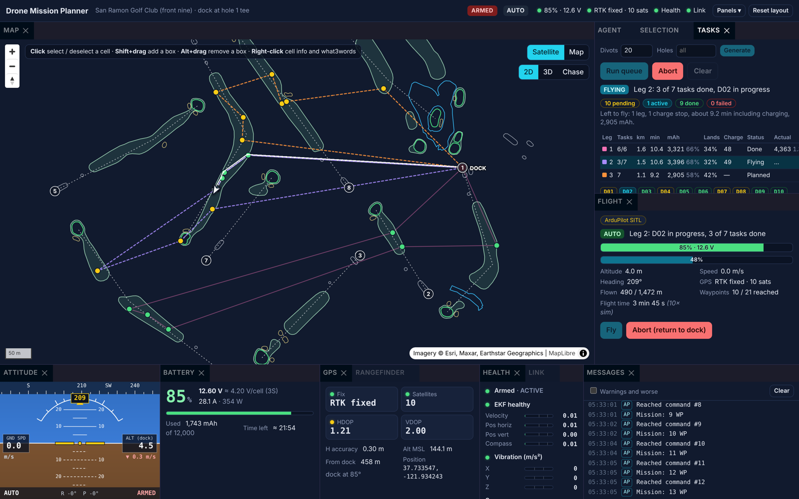
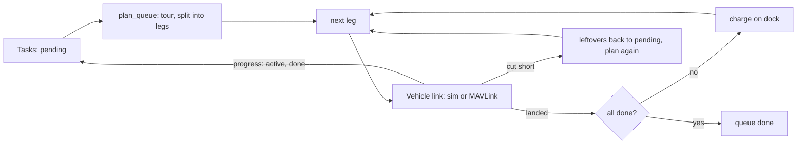

# Task queue, legs and charge stops

## In this project

The **Tasks** panel turns the drone from "fly this survey route" into "work
through this list of jobs". In simulation the jobs are fake golf **divots**:
spots inside the fairways that the drone flies to, descends over, holds at
(standing in for the repair or inspection a real payload would do) and climbs
away from. Each task has a status: **pending**, **active** (the drone is on
its way or working on it), **done**, or **failed**.

When the queue needs more energy than one battery holds, the planner splits it
into **legs**. Each leg takes off from the dock with a full pack, visits some
tasks, and lands back on the dock with at least the reserve left. Between legs
the drone **charges** on the dock (simulated), then flies the next leg. The
panel shows the legs with their predicted distance, time, mAh and battery on
landing, and after each leg what the vehicle actually used.



*20 fake divots on ArduPilot SITL (10x speed, November 2026). Leg 1 is done
and the drone charged on the dock; leg 2 is flying. The Actual column is the
SITL quad's measured mAh, about 1.3 times the placeholder model's prediction.*

| What | Where |
| --- | --- |
| Tasks and fake divot generation | [`backend/app/tasks.py`](../../backend/app/tasks.py) (`Task`, `generate_divots`) |
| Energy model (per-phase current, reserve, margin, charging) | [`backend/app/energy.py`](../../backend/app/energy.py) (`EnergyModel`, `estimate_leg`) |
| Splitting the queue into legs | [`backend/app/charge_plan.py`](../../backend/app/charge_plan.py) (`plan_queue`) |
| The planner / vehicle boundary | [`backend/app/vehicle.py`](../../backend/app/vehicle.py) (`LegMission`, `LegProgress`, `VehicleLink`) |
| The loop: fly a leg, update tasks, charge, repeat | [`backend/app/task_queue.py`](../../backend/app/task_queue.py) (`TaskQueue`) |
| Vehicle links | [`backend/app/sim.py`](../../backend/app/sim.py) (built-in sim), [`backend/app/sitl_drone.py`](../../backend/app/sitl_drone.py) and [`backend/app/mavlink_mission.py`](../../backend/app/mavlink_mission.py) (`build_leg_mission`) for ArduPilot |
| API | `GET /api/queue`, `POST /api/queue/divots`, `/run`, `/abort`, `/clear` in [`backend/app/main.py`](../../backend/app/main.py) |
| Panel and map layers | [`frontend/src/tasks.ts`](../../frontend/src/tasks.ts) |
| Headless SITL run with a report | [`backend/tools/fly_queue.py`](../../backend/tools/fly_queue.py) |
| Tests | [`backend/tests/test_task_queue.py`](../../backend/tests/test_task_queue.py) |



### Running it

In the app: open **Tasks**, set how many divots (and optionally which holes),
click **Generate**, then **Run queue**. **Abort** sends the drone home; the
queue stops after it lands and unfinished tasks stay pending. Works with
either flight backend.

Headless on SITL:

```bash
docker compose -f sitl/compose.yaml up -d          # SPEEDUP=10 for a quick run
cd backend
uv run python -m tools.fly_queue --divots 20 --seed 1 --charge-speedup 600
```

It prints the planned legs, progress, and a JSON report, and exits 0 only if
every task is done, every leg finished and landed within 3 m of the dock, and
the queue took the number of legs it planned.

### Settings (`backend/.env`)

| Variable | Default | Meaning |
| --- | --- | --- |
| `ENERGY_PACK_MAH` | `5000` | Pack capacity (4S). |
| `ENERGY_RESERVE_PCT` | `30` | Every leg is planned to land with at least this much left. |
| `ENERGY_MARGIN` | `1.15` | Every predicted mAh and second is multiplied by this. |
| `ENERGY_HOVER_A`, `ENERGY_CRUISE_A`, `ENERGY_CLIMB_A`, `ENERGY_DESCENT_A` | `20`, `20`, `26`, `16` | Current draw per flight phase. Placeholders. |
| `CHARGE_C` | `1.0` | Charge rate (1C is 5 A for a 5000 mAh pack). |
| `CHARGE_SPEEDUP` | `60` | Simulated charging runs this many times faster than real time. |
| `DIVOT_SERVICE_ALT_M` | `4` | Height above the dock to work at a divot. |
| `DIVOT_SERVICE_S` | `15` | Default time on station per divot. |
| `QUEUE_GUARD_PCT` | `20` | Cut a leg short if the vehicle's battery reads below this. |

## Background

**Charge stops are a vehicle routing problem.** Visiting points from a depot
with a limited "capacity" per trip (here, energy per battery) is the
capacitated vehicle routing problem. It is NP-hard, so practical planners use
heuristics. A classic one is **route first, cluster second** (Beasley, 1983):
build one tour through every point as if there were no limit, then cut the
tour into trips. For a fixed tour, the best way to cut it can be found
exactly with a short dynamic program over the cut points, because every trip
is a consecutive run of the tour. The result is usually close to what much
more expensive methods find.

**Battery energy for a multirotor.** A multirotor spends most of its energy
just holding itself up, so hover current is the number that matters most.
Forward flight at moderate speed often draws a little less than hovering
(translational lift), climbing draws more, descending less. A simple and
common planning model is a fixed current per phase, times a safety margin,
with a landing reserve: a LiPo's voltage drops off quickly near empty, cold
packs and wind take more, and an old pack holds less than its label. The
reserve is not spare energy; it is what's left when the model was wrong.

**Charging.** A LiPo charges at constant current until it reaches 4.2 V per
cell, then at constant voltage while the current tapers. At 1C the
constant-current part refills about the used fraction of an hour; the taper
adds more. Faster charging is possible but wears the pack.

## Our choices and limits

- **The energy model is uncalibrated.** Every current in `EnergyModel` is a
  placeholder for a Holybro X500 V2 class quad on a 4S ~5000 mAh pack, picked
  on the high-draw side, and the app labels it so. No flight time here is a
  claim about the real drone. To calibrate: fly a logged hover and a logged
  survey leg, read the average current for each phase from the log
  (`BAT.Curr` in ArduPilot dataflash logs), and set the `ENERGY_*` variables.
  The Tasks panel already shows measured mAh next to the prediction for every
  leg (`actual.mah_vs_plan`), which is the number to watch.
- **Route first, split second, then re-order each leg.** We build one tour
  with `planner.plan_tour` (nearest neighbor plus 2-opt), split it with an
  exact dynamic program (fewest legs first, then least energy), and re-run the
  tour planner inside each leg, keeping whichever order is cheaper. A full
  vehicle routing solver (for example OR-Tools) could balance legs better; at
  tens of tasks on one course the difference is small, and this has no
  dependencies. See [decision D10](../decisions.md#d10-route-first-split-second-for-charge-stops-with-a-conservative-energy-model).
- **Plans can be lopsided.** Fewest legs first, then least energy, can leave
  one short leg and several full ones. That costs nothing extra in energy, but
  a balanced split would charge less between legs. Not handled yet.
- **Plan once, plan again only when something changes.** The plan made when
  divots are generated is flown as is. If a leg ends early (abort, battery
  guard) its unfinished tasks go back to pending (failed after
  `tasks.MAX_ATTEMPTS` tries), and what's left is planned again.
- **A task that can't be reached on one full battery fails at once** with
  "Out of range". Nothing tries to stage it from somewhere else.
- **Every leg starts on a full pack.** If the pack reads under 97% before a
  leg (including the first), the queue charges first.
- **Battery guard on the vehicle's own reading.** During a leg, if the
  vehicle reports less than `QUEUE_GUARD_PCT`, the leg is cut short and the
  drone returns. Plans land with 30% or more, so the guard only fires when the
  model was wrong. On a real vehicle, ArduPilot's own battery failsafe
  (`BATT_LOW_MAH`, `BATT_FS_LOW_ACT`) stays the last line of defense and
  should be set up with the airframe. The guard is a fixed percentage, not
  "enough to get home from here": in a test where the vehicle draws three
  times the model, it still brings the drone home, but over-draws the pack
  on the way. A distance-aware guard would compare the energy to fly home
  with what's left.
- **Charging is simulated.** The queue waits `CHARGE_C`-rate charge time
  divided by `CHARGE_SPEEDUP`, then calls the link's `recharge`. The built-in
  sim resets its pack; on SITL that is `MAV_CMD_BATTERY_RESET`, which tells
  ArduPilot's battery monitor the pack is full. On real hardware `recharge`
  must instead wait for the dock to report a full pack (or a pack swap), and
  never reset the battery monitor by command.
- **SITL is not the airframe, and its battery is not the model's.** SITL's
  generic quad draws more than the placeholder X500 currents (about 1.3 to
  1.4 times the prediction, margin included, in our runs), on SITL's 12000
  mAh placeholder pack from `sitl/planner.parm`. So on SITL the prediction
  column is the X500 model and the actual column is SITL's quad; the
  difference is expected and is exactly what calibration would close. The
  built-in sim draws the model's currents without the margin, so it always
  lands a little under the prediction.
- **Landing on the dock is not precise yet.** Legs land with ArduPilot's
  normal `NAV_LAND` at the dock's GPS position (within a meter or so in SITL).
  Landing on a real charging pad needs precision landing (ArduPilot's `PLND_`
  parameters with an IR beacon or a camera target) and a dock that reports
  when it is charging.
- **The divots are fake.** They are random points inside OSM fairways, at
  least 6 m apart, with the same time on station. Real tasks would come from
  imagery (a survey flight that finds divots) or from the grounds crew.
- **The vehicle link is the boundary to real hardware.** `SitlDrone` speaks
  plain MAVLink mission protocol to whatever is at `SITL_CONNECTION`. A real
  Pixhawk 6C Mini is the same code with a serial or telemetry-radio
  connection string, once the parameters, failsafes, recharge and a GCS
  safety pilot are in place. That last part is not done or tested here.
